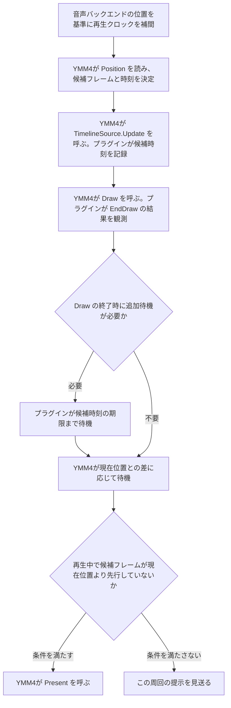

# プレビュー再生のタイミング

プレビュー用の映像プレーヤーごとに再生クロックを持ちます。音声バックエンドの再生位置を基準に、サンプル間の位置を `Stopwatch` で補間します。YMM4はその位置を使って候補フレームを選びます。描画が候補時刻より早く終わった場合は、プラグインが `Draw()` の終了時に待機し、そのあとYMM4が通常の待機と提示の判定を行います。

## 音声位置から提示まで



この図は通常再生で描画に進んだあとの提示判断までを示しています。候補を選ぶとき、YMM4は現在位置をタイムライン上のフレーム番号に変換します。前回提示したフレームと同じ番号なら、次のフレームを候補にします。各メソッドで処理を追加する位置は[YMM4への変更箇所](ymm4-integration.md#再生タイミングのパッチ)にあります。

## 音声を基準にした再生クロック

`TimelineAudioPlayer.Position` の取得時に、プラグインは `AudioPlayer.CurrentPosition` と `StartPosition` の和を音声サンプルとして採取します。通常の採取間隔は約33 ms以上です。音声デバイスがある場合はバックエンドの再生速度を使い、デバイスがなく経過時間を返す経路では100%として補間します。バックエンドが起動するまでは、利用できる保持位置またはYMM4の `Position` を使います。

採取した位置と `Stopwatch` の時刻を補間の基準点にします。同じ再生区間では、補正後も最後に返した位置より戻らないようにし、タイムライン終端を上限にします。これにより、YMM4の音声位置通知の間にも映像側が位置を読み取れます。サンプリングは [PlaybackTimingClockHooks.Audio.cs](../src/YMM4PlaybackTimingPlugin/Integration/PlaybackTimingClockHooks.Audio.cs)、位置と期限の計算は [PreviewPlaybackClock.cs](../src/YMM4PlaybackTimingPlugin/Playback/PreviewPlaybackClock.cs) にあります。

## 描画が終わったあとの待機

1. `TimelineSource.Update` の開始時に、引数の候補時刻と連番をソースに対応付けます。YMM4の映像ワーカーが `Playing` 用途で呼び出し、元の処理が正常に完了した場合に待機候補として確定します。一時停止中や書き出し用の `Update` は待機対象から外れます。
2. `Draw` の開始時に、候補のソース、連番、ワーカーの `Task` とスレッドを照合します。終了時に `EndDraw()` の成功、例外やキャンセルの有無、パッチ構成とプレーヤーの状態を確認します。候補が最新でクロックが有効な場合に限り、待機に進みます。
3. クロックは候補のメディア時刻を `Stopwatch` 上の期限に変換します。期限に達している場合や初回計算で500 msを超える場合は、追加待機を省きます。待機中は期限を再計算し、ソースの候補やクロックの世代が変わったら中断します。

待機はWindowsの高分解能待機タイマーを優先し、利用できない場合は残り時間に応じて `Thread.Sleep`、`Thread.Yield`、短いスピン待機を使います。タイマーや `Sleep` に渡す1回分の待機時間は最大50 msで、通常の設定では残り約0.25 msからスピン待機を使います。待機する時点では、`Update` のロックは解放済みです。提示の成否は後続の `Present()` が確定します。[PreviewFrameDeadlineWait.cs](../src/YMM4PlaybackTimingPlugin/Playback/PreviewFrameDeadlineWait.cs)・[PreviewPlaybackSession.cs](../src/YMM4PlaybackTimingPlugin/Playback/PreviewPlaybackSession.cs)

## 一時停止・シーク・速度変更

| 状態の変化 | クロックと待機の扱い |
| --- | --- |
| 再生開始 | YMM4の位置を初期値にし、音声サンプルを受け取ってからクロックを有効にする。 |
| 一時停止 | `EndAudioTask()` の開始時に古い待機を失効させる。バックエンドが切り離されたあと、実際に停止する直前の音声位置を確保し、`IsPlaying` が `false` に変わる前にYMM4の `Position` に反映する。 |
| シーク | 再生中のサンプルや位置設定値が補間位置から100 ms以上離れた場合、新しい区間として基準点を更新し、古い候補を失効させる。移動量がしきい値未満の場合は補間の基準を補正する。 |
| 再生速度や音声の速度モードを変更 | YMM4が異なる速度・モードを検知して音声バックエンドを切り替えるときは、移行時点の位置を保持する。新しいバックエンドの位置が進み、保持位置に追いついたところで補間を再開する。 |
| ソースの交換・破棄、プレーヤーの破棄 | 対応する候補を失効させる。セッションを終了するときは実行中の待機が抜けてからタイマーを解放する。 |

一時停止時に確定位置を引き継げなかった場合など、クロックを継続できないと判断した場合は位置の補間と追加待機を止め、YMM4の位置に戻ります。[PlaybackTimingClockHooks.cs](../src/YMM4PlaybackTimingPlugin/Integration/PlaybackTimingClockHooks.cs)・[PlaybackTimingClockHooks.Audio.cs](../src/YMM4PlaybackTimingPlugin/Integration/PlaybackTimingClockHooks.Audio.cs)

## YMM4の再生ループを使った試験

[Releaseビルド](README.md#ビルドと梱包)のあと、`warm-long` でYMM4の再生ループを事前に動かし、パッチ登録後の長時間再生を確認します。

```powershell
dotnet run --project tests/YMM4PlaybackTimingPlugin.Tests -c Release --no-build -- --native-loop warm-long
```

再生ループの試験は非表示のウィンドウハンドル（HWND）、小さな画像、実デバイスを使わない音声バックエンドを使います。確認対象はこの構成での再生ループとパッチの動作です。実際の音声出力やモニターの表示FPSを確認するには別途実機での測定が必要です。[IndependentNativeLoopTests.cs](../tests/YMM4PlaybackTimingPlugin.Tests/IndependentNativeLoopTests.cs)
